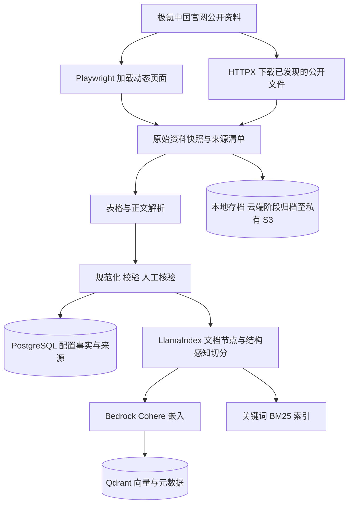
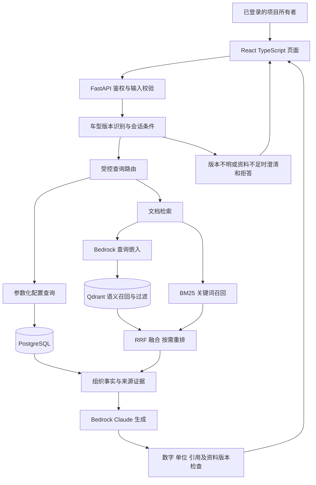
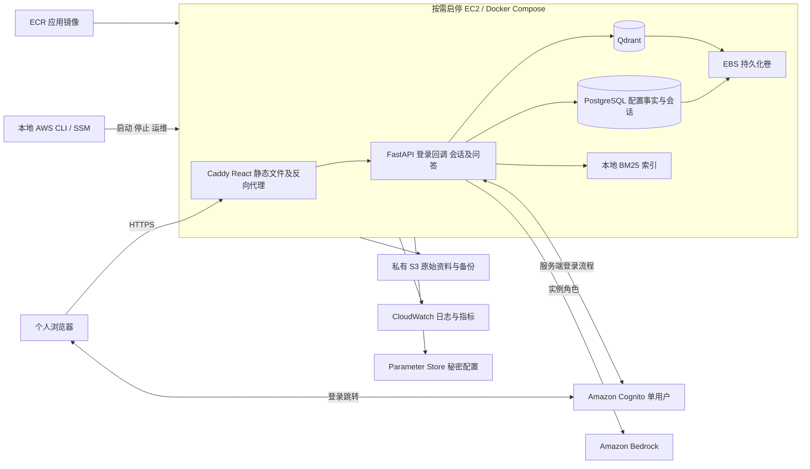

# CarKnowledgeRAG 架构说明

步骤：A8.1。整理日期：2026-11-04（Australia/Sydney）。
代码基线：`591718b30e13c07ab187d57fac9e3b56abf9c9c5`。

本文描述当前实现和目标架构。除“当前实现”外，图中的业务与云组件均为计划，
不表示已经部署、可调用或通过集成验收。技术选择沿用已确认规划；待验证项不在本步擅自定案。

## 1. 目标与边界

系统仅供项目所有者使用，完成车辆知识问答学习与客户需求调研，不承诺生产高可用。
覆盖极氪中国大陆官网采集快照中展示的全部车系及配置版本，支持配置查询、解释、比较、
条件筛选、多轮澄清和资料不足回答。问答时不联网搜索，不查询库存、实时优惠或给主观推荐。

A3 于 2026-10-15 调查到 11 个官网车型入口、35 个基础配置列。
这不是 2026-11-04 的最新清单，也不等于全部选装组合或实时可下单车型。
正式采集时重新核对导航、版本及公开资料入口。

## 2. 当前实现

| 已有部分 | 代码或证据 | 当前能力 |
| --- | --- | --- |
| Python 环境 | `pyproject.toml`、`uv.lock`、`.python-version` | Python 3.11、uv、开发依赖锁定 |
| 启动入口 | `car_knowledge_rag/__main__.py` | 校验配置后输出启动日志，不提供 HTTP 服务 |
| 配置 | `car_knowledge_rag/config.py` | 环境变量 > 当前工作目录 `.env` > 默认值；非法值拒绝启动 |
| 日志 | `car_knowledge_rag/logging_config.py` | UTC、stderr、级别过滤、应用 Logger 与子 Logger |
| 异常教学 | `car_knowledge_rag/logging_demo.py` | 独立错误日志示例，不进入正常启动路径 |
| 质量检查 | `tests/`、`.github/workflows/ci.yml` | pytest、Ruff；push/PR 触发 Linux CI |

当前只定义 `APP_ENV`、`LOG_LEVEL`。数据库、模型和认证配置尚未添加。
现有 CI 只检查代码，不构建镜像、不发布应用。
A7 的历史验收记录：[成功 CI](https://github.com/WeiliangJia/CarKnowledgeRAG/actions/runs/41590373866)，
17 项测试及 11 个子测试通过；本步未重新运行该工作流。

## 3. 离线数据流（计划）

### 职责

- Playwright 等待配置列和参数行实际出现；空壳页面不直接视为官方缺少资料。
- 原始快照保存来源 URL、采集时间、内容哈希和官方批次标识，不被清洗结果覆盖。
- Beautiful Soup、pandas、Pydantic 分别承担结构解析、统计检查和数据校验。
  PDF/OCR 仅在实际资料需要时引入，不预装为必经流程。
- PostgreSQL 保存版本、配置值、单位、状态、适用条件、脚注和来源关联。
- 正文按语义或段落切分；配置表保留列名、行名、版本、单位和脚注，不能盲目按长度切碎。
- Qdrant 保存片段向量及过滤元数据，不替代完整关系数据库。
- BM25 由已核验文档构建；OpenSearch 是后续本地专题实验，首版不默认云端常驻。

### 一致性与更新

关系数据、文档片段、向量与关键词索引用稳定标识及资料快照关联。
多存储写入不具备天然的跨系统事务：导入失败需要可重试，重复导入要去重，
切换有效数据版本前需要验证各索引一致。具体发布和回滚机制在数据更新步骤实现。
电池、座位及选装条件不能只压缩成一个版本名称；不由官网代码推断自然年款。

## 4. 在线问答流（计划）

查询路径按问题确定：

| 问题 | 主要路径 | 原因 |
| --- | --- | --- |
| 某版本的电池容量 | SQL | 精确字段与版本匹配 |
| 哪些版本符合条件 | SQL | 遍历完整收录范围，不把召回结果当全部车型 |
| 两版本配置比较 | SQL，必要时补充文档 | 数值、配置状态和条件保持一致 |
| 某功能的官方说明 | 文档检索 | 需要说明段落与引用 |
| 配置解释与比较结合 | SQL + 文档检索 | 同时需要事实与说明 |

精确事实可以确定性展示，不要求每次 SQL 查询都调用模型。
图中的生成链路是需要自然语言解释时的组合方式。
模型不任意执行 SQL，也不访问公网补充车辆配置；资料内容视为证据，不作为系统指令。
“最高”“最快”等宣传值不得无条件套用到整个车系。

### 接口最小边界

- 问答请求：问题、会话标识、可选车型条件；身份由服务端会话确定。
- 问答结果：答案、来源引用、采用的数据版本及必要的澄清提示。
- 页面只调用业务 API；不直接连接 PostgreSQL、Qdrant 或持有 AWS 密钥。
- 更新和评测先由离线命令执行，不默认开放公网管理接口。

具体端点、字段类型和错误码在 API 步骤确定，本文不宣称已有接口。

## 5. AWS 部署与身份边界（计划）

### 安全边界

- Cognito 只创建个人账号，关闭自助注册；FastAPI 仍需检查允许的用户身份。
- 后端处理 OIDC 回调并校验登录流程，使用服务端会话及安全 Cookie；状态修改请求防护 CSRF。
  React 页面与 API 同站点；登录失效后不能通过直接调用 API 绕过保护。
- 数据库及 Qdrant 端口只允许内部访问；公开业务入口为 HTTPS，不公开数据库和运维端口。
- 应用通过实例角色调用 AWS；秘密不进入仓库、镜像、前端或日志。
- 用户登录权限、EC2 服务角色及 GitHub 发布角色是不同身份，不互相替代。
- 统一日志并不自动脱敏；外部异常和文档内容仍要控制记录范围。

### 成本与恢复边界

- 使用前启动 EC2，等待就绪后访问；停止期间服务不可用，不承诺全天在线。
- EBS 与必要备份持久化，停止计算不等于全部资源停止收费。
- 单机承载应用和数据库，故障可能同时影响所有服务；用备份和恢复演练降低数据损失风险。
- PostgreSQL 备份、Qdrant 快照及数据版本清单配套保存，验证在干净环境恢复。
  应用镜像回滚不能替代数据库与索引恢复。
- 域名、稳定地址、证书、区域、实例规格、网络规则与实际费用在部署步骤验证。
  不在本文承诺固定账单，也不默认创建 RDS、ALB、NAT Gateway 或托管搜索集群。

## 6. 技术映射与交付关系

| 子系统 | 沿用的目标技术 | 实施阶段 |
| --- | --- | --- |
| 前端 | React、TypeScript、Vite、Ant Design、ESLint | 页面阶段 |
| API | FastAPI、Pydantic、Uvicorn | 服务阶段 |
| 数据访问 | PostgreSQL、SQLAlchemy 2.x、psycopg、Alembic | 存储阶段 |
| 文档检索 | LlamaIndex、BM25、RRF、Qdrant | 基础 RAG 与检索实验 |
| 模型 | Bedrock Claude Sonnet 4.6、Cohere Embed Multilingual v3 为首选 | 嵌入与生成接入前验证 |
| 部署 | EC2、Docker Compose、Caddy、Cognito、S3、ECR、SSM、CloudWatch | AWS 阶段 |
| 基础设施与发布 | Terraform、GitHub Actions OIDC | 部署及自动发布阶段 |

生成模型与嵌入模型分工不同；模型、区域和权限未在本步调用验证。
未来发布流程为 CI 通过后构建镜像、推送 ECR、经受控发布步骤更新 EC2、健康检查及必要回滚。
当前仓库工作流仅执行 Ruff 和 pytest，不能视为上述发布链路已完成。

## 7. 阅读检查

1. 为什么“哪些车型满足条件”不能只依赖 Qdrant 的 Top-K？
2. Cognito 登录成功后，为什么 API 仍需要权限检查？
3. EC2 停止后，为什么还需要保留数据和计算存储费用？

答案：Top-K 不是完整集合；身份认证不等于业务访问授权；计算停止不删除持久化与备份资源。
